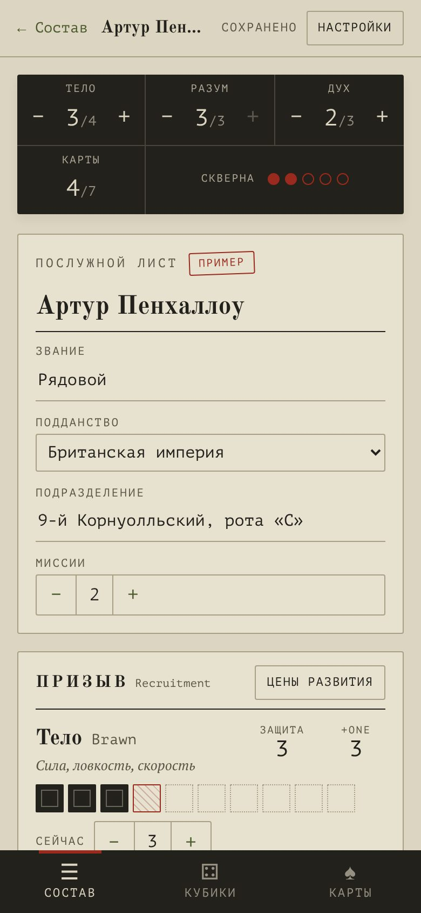
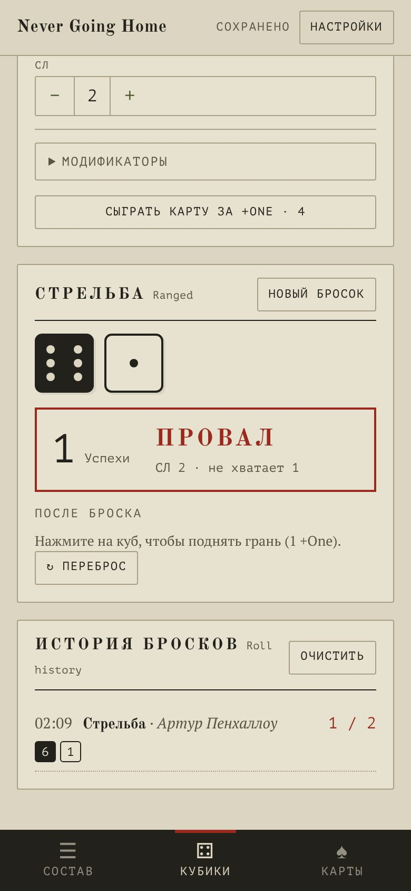
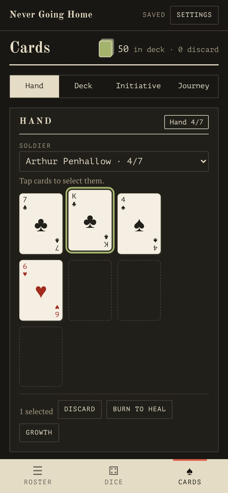

# NGH Companion

**Неофициальное приложение-компаньон для настольной ролевой игры Never Going Home (Wet Ink Games).**
Лист солдата, кубики +One и колода карт в одном приложении для Android и Windows. Работает без интернета и без регистрации.

*An unofficial companion app for the Never Going Home tabletop RPG by Wet Ink Games: soldier record, +One dice and the card deck, for Android and Windows. Offline, no account. [English below](#english).*

  
  
  

## Скачать

Последняя версия — на странице **[Releases](https://github.com/ahabwhitewhail/ngh-companion/releases/latest)**:

| Платформа | Файл | Установка |
|---|---|---|
| Android 7+ | `NGH-Companion.apk` | Откройте файл на телефоне и разрешите установку из этого источника. Play Защита может предупредить о неизвестном разработчике: «Всё равно установить». |
| Windows 10/11 | `NGH-Companion-Windows.zip` | Распакуйте папку целиком и запустите `NGH-Companion.exe` (рядом должен лежать `resources.neu`). На предупреждение SmartScreen: «Подробнее» → «Выполнить в любом случае». |

Данные хранятся только на вашем устройстве. Чтобы перенести солдата на другое устройство: на листе «Скопировать JSON», на другом устройстве «Состав» → «Импорт».

## Что умеет

**Лист солдата**
- Тело, Разум и Дух: текущее значение и ранг, Защита и манипуляции +One, Броня и СЛ попадания.
- 9 навыков с отметками, до 6 Путей Шёпота с ритуалами (по одному на отметку) и напоминанием о проверке Скверны на 3-й, 4-й и 5-й отметке.
- Скверна, которую можно скрыть от других игроков. Оружие из таблицы книги с уроном и способностями. Снаряжение, послужной список, личная история, заметки.
- Журнал изменений с отменой, автосохранение, проверка правил призыва, цены развития, завершение Миссии.
- Несколько солдат, копия, экспорт и импорт.

**Кубики +One**
- Кубы по обучению, манипуляции по текущему атрибуту.
- Докупка кубов, необученный навык, подъём граней, переброс, карта за +One.
- Цены Путей Шёпота (урон себе или сброс карты за автоуспех), ручные модификаторы, сравнение со СЛ, лишние успехи на способности оружия, история бросков.

**Карты**
- Колода 54 карты (или 2 колоды для 6+ игроков), рука до 7 карт, награды, стартовые 3 карты.
- Лечение картой, развитие за карты с проверкой правил (красные для атрибутов, одна масть, картинки и тузы).
- Проверка Скверны с джокерами, Инициатива для солдат и Противников, Путешествие с раздачей и темами мастей, сетка «где какая карта», журнал колоды.

Интерфейс на русском и английском, светлая и тёмная тема, размер текста. Рядом с переводом можно показывать английские термины книги.

## Что нужно знать

- **Это фанатский проект**, он не связан с Wet Ink Games и не одобрен ими. Never Going Home, правила, названия и сеттинг принадлежат Wet Ink Games. Для игры нужна книга правил Never Going Home Core Rulebook (издаёт Wet Ink Games); приложение её не заменяет и не содержит её текста.
- Русские названия терминов — неофициальный перевод автора приложения.
- Где правила можно прочесть по-разному, приложение делает так: сыгранный джокер замешивается обратно в колоду (сброс остаётся до конца Миссии); в Инициативе джокер считается тузом; в развитии он подходит под любую масть и цвет.

## Планы

- [x] Лист солдата
- [x] Кубики и карты
- [ ] Справочник с поиском и категориями (свои пересказы со ссылками на страницы книги)
- [ ] Иконка приложения, резервная копия всех данных одним файлом

Нашли ошибку или расхождение с правилами — откройте [Issue](https://github.com/ahabwhitewhail/ngh-companion/issues) с номером страницы книги.

---

## English

**Download:** grab `NGH-Companion.apk` (Android 7+) or `NGH-Companion-Windows.zip` (Windows 10/11) from **[Releases](https://github.com/ahabwhitewhail/ngh-companion/releases/latest)**. On Android, allow installing from that source. On Windows, unzip the whole folder and run `NGH-Companion.exe`; if SmartScreen warns, choose *More info → Run anyway*.

**Features**
- *Soldier record:* Brawn, Smarts and Guts (current and rank), Defense, +One, Armor; 9 skills; up to 6 Whisper Paths with rituals and Corruption reminders; hideable Corruption track; weapons with damage and abilities; gear, service record, history, notes; change log with undo; autosave; recruitment check; growth costs; End Mission.
- *+One dice:* training dice and attribute manipulations, buy dice, untrained skills, add pips, reroll, cards for +One, Whisper Path costs, modifiers, TN check with extra successes, roll history.
- *Cards:* 54-card deck (or two decks), hand of 7, rewards, healing and growth with cards (rule-checked), Corruption draws, Initiative, Journey, deck map and log.
- Russian and English UI, light and dark themes, adjustable text size. Everything stays on your device.

**Fan project.** Not affiliated with or endorsed by Wet Ink Games. Never Going Home and its rules, names and setting are © Wet Ink Games. You need the Never Going Home Core Rulebook (published by Wet Ink Games) to play; the app contains no rulebook text.

## Build from source

    npm install
    npm run dev           # http://localhost:5173
    npm run build         # web build in dist/
    ./desktop/build.sh    # Windows portable zip (Neutralinojs) in desktop/out/

**Android:** needs JDK 17 and the Android SDK.

    npx cap add android && npx cap sync android
    cd android && ./gradlew assembleDebug

**CI:** `.github/workflows/build.yml` builds both apps on every push and pull request. To release, raise `version` in `package.json` and add notes to `CHANGELOG.md`: when that reaches `main`, CI publishes Release `v<version>` with the APK and the Windows zip.

**Code map**
- `src/rules.ts` — attributes, skills, Whisper Paths, weapons, growth costs (with rulebook page refs)
- `src/store.ts` — data model, autosave, change log, undo
- `src/cards.ts`, `src/deckOps.ts` — deck model and every card move
- `src/dice.ts`, `src/components/Dice.tsx` — d6 and +One manipulations
- `src/components/Sheet.tsx`, `Cards.tsx` — screens
- `src/i18n.ts`, `src/i18n-tools.ts` — Russian and English strings

Pull requests are welcome: translations, rule fixes (cite the page), accessibility.

## License

Code: [MIT](LICENSE). The game itself is not covered by this license.
